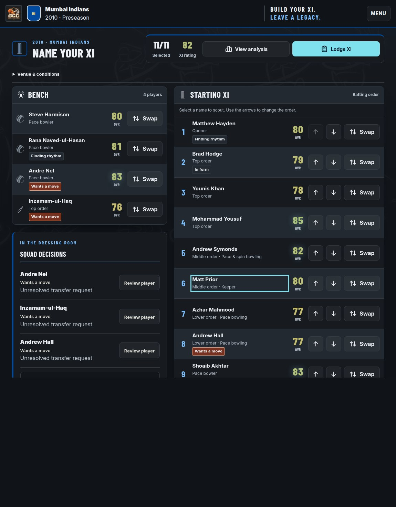
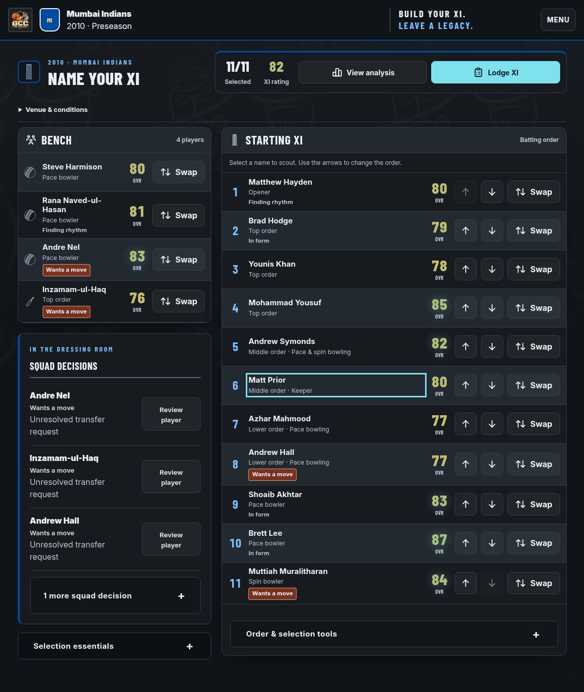
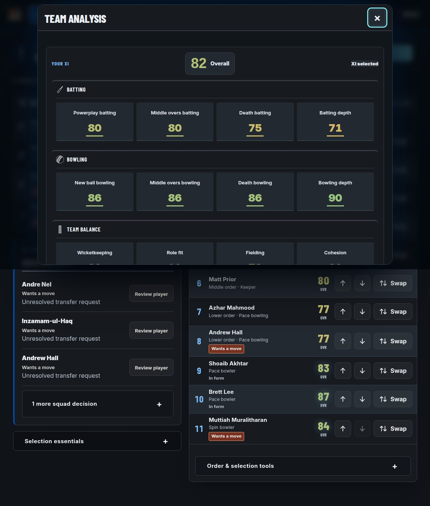
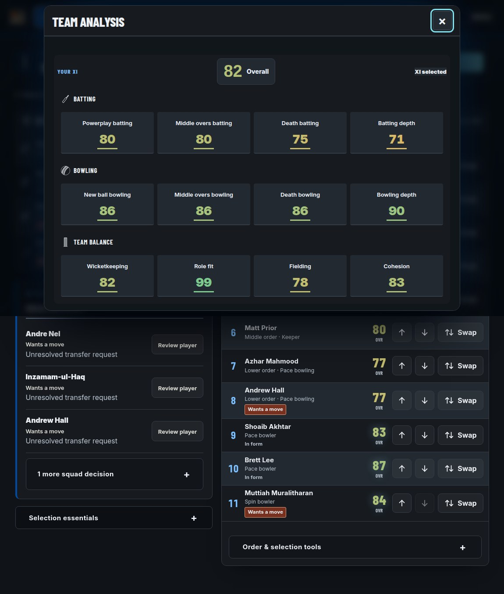

# GCC roster and analysis correction review

13 November 2026. Continuation of the whole-interface audit; this is a bounded component correction, not a new whole-game aesthetic score.

## Result

The starting XI is more compact without losing names, roles, ratings, form text or manual controls. Team analysis removes redundant section borders and reduces spacing while retaining its twelve metrics, three discipline groups and rating colours.

The original desktop bench/XI split remains. An initial narrower-bench trial passed containment tests but wrapped long bench names awkwardly at1150px. It was rejected after visual inspection. The accepted candidate retains the original column proportions.

| Measured area | Before | After | Reduction |
|---|---:|---:|---:|
| Eleven starting-XI rows,1440/1150width |968.5px|848.2px|120.3px|
| Eleven starting-XI rows,390width |1436.5px|1392.5px|44px|
| Analysis summary,1440/1150width |653px|567px|86px|
| Analysis summary,390/320width |1011.9px|901.9px|110px|

These are measured rendered heights in the generated test career, not guarantees for every player-name or injury/status combination. Rows expand for content.76px is the new desktop minimum, not a forced height.

## Corrections and ownership

- Existing decision-owner XI row minimum88→76px; vertical padding10→8px; scoped name spacing4→3px.
- One scoped neutral-status selector inside the existing decision component owner removes padded badge chrome from routine form labels. Alert and promise classes are excluded. All status text remains.
- Analysis changes edit existing decision and charcoal rule bodies: outer padding/border, section top borders and heading dividers, section spacing, tile minimum/padding/gap and value line-height.
- The28px analysis values and existing label-height reservation remain. The metric tiles are noninteractive divs; no new click behavior was invented.
- All 22script bodies remain byte-identical.17 existing style blocks remain; no stylesheet was added. The component selector is not an appended visual override layer.

## Native verification

[GitHub Actions run43280528648](https://github.com/cpuhater1234/global-champions-cricket/actions/runs/43280528648) passed.

- Fourteen paired XI states at1440,1280,1150,1024,768,390and320widths.
- Roster text/IDs preserved; neutral status chrome removed; alert/promise colours and padding preserved.
- Ordering/swap controls retain44px dimensions and remain contained. Top-up and bottom-down arrows retain disabled states.
- Manual ordering and a nonkeeper swap were exercised in disposable data, preserving eleven distinct players and a recognised keeper.
- Ten paired analysis states at1440,1150,768,390and320widths.
- All twelve metric keys, labels, values and rating colours, all three groups and the selected XI remained identical.
- Metric child containment, summary reduction, lower-content scrolling and actual modal close/reopen controls passed.
- No reported action/page errors or document horizontal overflow in the compared states.

The test world comes from an actual generated2009 checkpoint, progressed legally to the next annual XI. It is separate from the user's Lucknow career. The user browser was used only to inspect the current build and was returned to Matchday at the last observed 2010, Round 3 state. No match, trade or selection action was performed in that career.

## Before and after evidence

| XI before | XI after |
|---|---|
|  |  |

| Analysis before | Analysis after |
|---|---|
|  |  |

Full-page screenshots of an open modal can append offscreen background below the physical viewport. That capture artifact is not a new modal leak. Normal scrolling and a conspicuous keyboard-focus outline are not treated as visual failures.

## Independent visual review

A fresh reviewer inspected the paired XI and analysis renders, including320px mobile. They judged this suitable as a bounded review candidate, with no material visual regression observed. The analysis improvement was strongest: all twelve metrics fit within the1150×720 modal viewport. They retained the remaining concerns about mobile scrolling, repeated squad decisions and the redundant mobile “XI selected” strip. This does not constitute full-game release approval.

## Remaining work and limits

The repeated squad-decision module, mobile XI action layout, tall club/draft-order cards, some player/trade spacing, live long-club-name alignment and remaining match-specific surfaces are still in the audit backlog. This pass does not claim to have solved those areas or raise the previous whole-portfolio 71/100 assessment without a new broader review.

Full maintained-source/build parity also remains unverified. Exact guarded composers protect the delivered artifact because wholesale importing the maintained CSS would introduce unrelated undelivered grid changes. Main and the frozen release remain unpromoted by this review.

## Candidate

File:GCC_v116_Roster_Analysis_Review.html

SHA-256:94a4d771548cbba76798461bf73bd2f888c12e9fed4bda6e6b7b2bd99a7faf41

Bytes:6,654,689

Baseline:GCC_v116_Cohesive_UI_Review.html, SHA-25632a4802cfd8a1ceba0cf26cdd5a9c740c0fcf7a15432329922912f832b38d10e.
