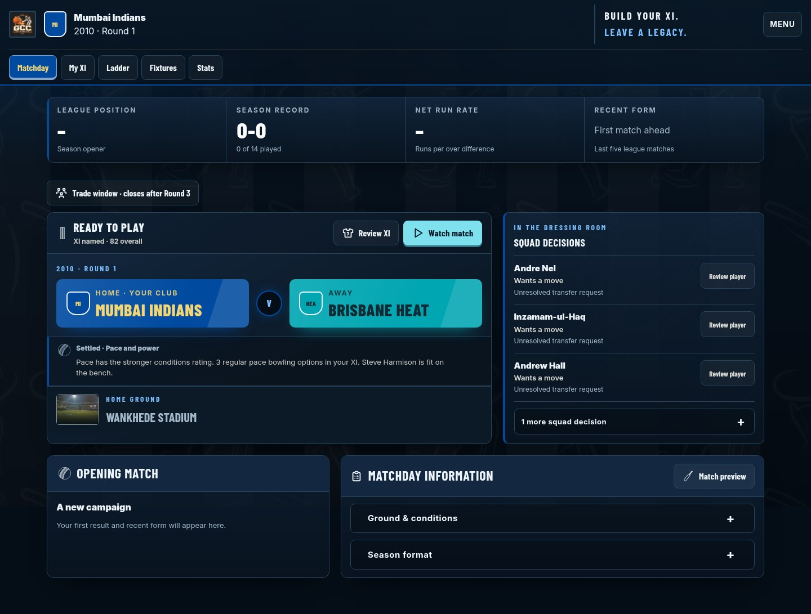
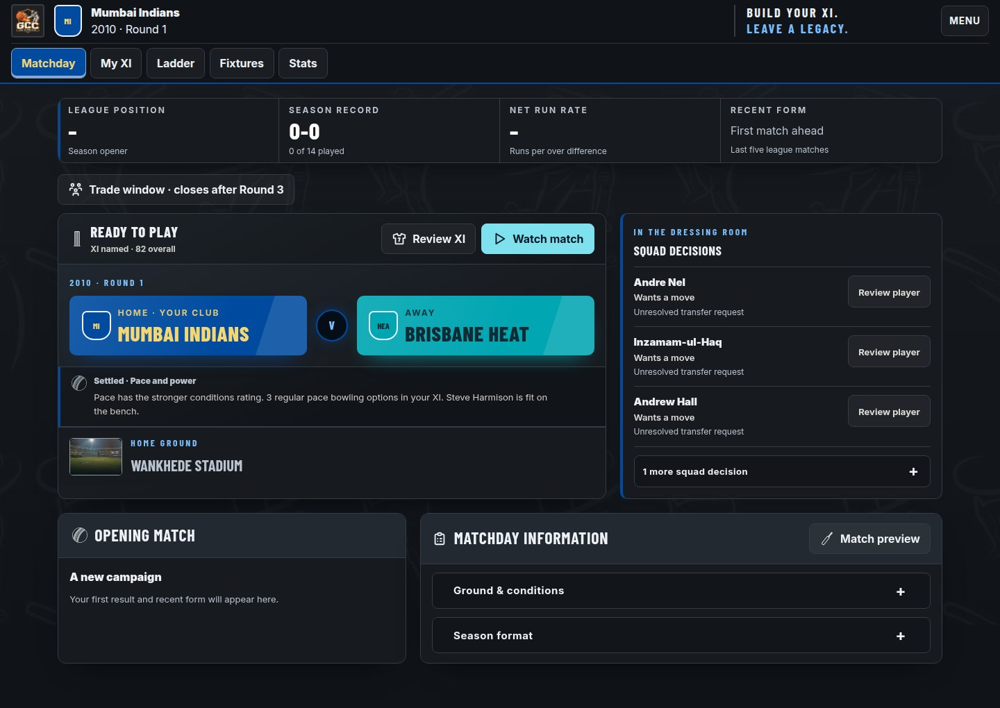

# Global Champions Cricket: visual audit and controlled correction review

13 November 2026, Australia/Sydney

## Verdict

The corrected candidate is materially cleaner and more coherent than the Guide Surface Review baseline. Ordinary controls now use the same readable type, recurring Matchday chrome is smaller, and shared surfaces use a restrained charcoal palette. Club colours, cricket imagery, player rating plates and championship emphasis survive.

It is not yet a finished premium interface. Remaining weaknesses are excessive containment, repeated squad-decision content and several mobile layouts that are too tall. The independent assessment of eight corrected screen families is **71/100**. This is an observed portfolio score, not an assertion that every game state is release-ready.

## Builds and boundaries

| Item | Identity |
|---|---|
| Baseline | GCC_v116_Guide_Surface_Review.html |
| Baseline SHA-256 | 79a2fbfe965453ad0ef04d238ee7047346fb38e537deeec47d91cfcbebf51c4a |
| Corrected review candidate | GCC_v116_Cohesive_UI_Review.html |
| Candidate SHA-256 | 32a4802cfd8a1ceba0cf26cdd5a9c740c0fcf7a15432329922912f832b38d10e |
| Candidate size | 6,654,502 bytes |
| Source of corrections | Guarded edits to existing inline ownership rules, recorded by QA candidate builders |
| Functional scope | CSS only. All 22 script bodies remain byte-identical to the baseline. |
| Stylesheet inventory | 17 existing style blocks. No new stylesheet or appended override layer. |
| Release boundary | Private QA branch. Frozen release and main were not promoted by this work. |

The user's Lucknow career was inspected through navigation and read-only dialogs, then returned to Matchday at 2010, Round 3. No fixture was played, XI/roster changed, trade submitted or captaincy plan changed. Navigation can update the saved view; this is not a claim that browser storage received zero writes.

## How the review was conducted

Separate review passes considered art direction, sports-game composition, UX, design-system consistency, frontend ownership and final creative quality. They challenged blanket simplification: a recurring Matchday summary should be compact, while a championship scene can legitimately be celebratory. A clear focus ring is useful interaction feedback. Equal-height desktop cards can be beneficial. Ordinary scrolling is not clipping.

The live browser inspection covered Matchday, manual XI, analysis, player reports, ladder, fixtures, statistics, preparation/captaincy, an existing result and the trade form. Isolated native browser contexts supplied fresh onboarding/drafting and actual completed-career checkpoints from 2009, 2019, 2025 and 2026. Desktop 1440×900, laptop 1280×720 and mobile 390×844 were captured. Earlier guide testing also covered narrower sizes and landscape.

Historical finals scenes were reconstructed by changing the presentation stage of actual completed finalists/results in disposable contexts. They are labelled accordingly. They are not evidence that a new live finals transition was exercised in that capture.

The engine/controller harness separately completed 19 seasons, 266 regular matches and 16,564 checks with zero reported errors. Its VM DOM does not certify visual quality, browser storage durability or latency. Earlier native save/reload and two-tab checks belong to the accepted baseline; unchanged scripts reduce regression exposure but do not turn those older runs into new tests of every interaction.

## What changed and why

| Correction | Governing ownership | Result |
|---|---|---|
| Ordinary button typography | Existing Floodlit app/dialog rules, specific tab rules and Home action rule | Inter for operational controls; display typography retained for sporting headings and ratings |
| Control motion/depth | Existing Floodlit hover/active and cleanup primary rule | Removed translation and raised bottom shadow; retained meaningful hover, selected, disabled and focus states |
| Mobile player tabs | Existing perfection-pass player rule | Minimum height 42px to 44px |
| Recurring header | Existing base HUD floor/slogan/nav rules and decision owner padding | Removed obsolete 68px club-row floor and excess spacing; preserved logo, club/year/round and controls |
| Campaign strip | Existing decision geometry and winning Floodlit padding/type | Reduced noninteractive metric height and extra trade-entry gap |
| Shared palette/surfaces | Winning direct-app Floodlit tokens and existing shared background declarations | Charcoal panels/insets/raised surfaces; club, role, tier, action, success and warning colours preserved |
| Mobile Grand Final venue | Existing decision-owner mobile frame rule | Explicit full width addresses the narrow image frame; desktop composition remains the comparison baseline |

The measured Matchday action position improved from y392.3 to y322.3 at both 1440 and 1280 widths: **70px recovered**. At 390 width it moved from y575.8 to y499.4: **76.4px recovered**. Controls were not shrunk to obtain that gain.

### Before and after

These are actual generated-career captures, not design mockups. The comparison uses the same Mumbai 2010 opening-match state. Random stadium photographs in earlier Home captures were not used to justify an improvement score; later paired Home contexts use a test-only deterministic random seed.

| Before | Corrected shared controls, density and surfaces |
|---|---|
|  |  |

## Screen-by-screen findings

Scores are visual judgments, not automated measurements. The baseline columns combine independent observed assessments. Corrected scores are provided only where the final independent reviewer inspected the new rendering. A dash means not independently rescored, not a passing score.

| Screen | Baseline desktop / mobile | Corrected desktop / mobile | What works; remaining material issue; correction direction |
|---|---:|---:|---|
| Home | 6.5 / 6.3 | 7.2 / 6.8 | Logo, stadium and career action are clear. Framed composition remains heavy. Reduce containment selectively rather than removing cricket identity. |
| Intro | 7.0 / 6.8 | — | Clear premise and numbered sequence. Background illustrations compete with content. Quiet them; preserve unboxed steps. |
| Club selection | 6.7 / 6.0 | 7.1 / 6.0 | Club colours and ground summaries work. Mobile tiles and short descriptions retain excess space. Reduce specific minimum heights/padding while preserving desktop action alignment. |
| Completed club reveal | 6.4 / 5.5 | — | Identity and commitment state are explicit. Approximately 400px mobile cards produce a list above 3,300px. Compact completed-state cards and completion strip. |
| Signing week | 6.5 / 6.0 | — | Day sequence and totals are understandable. Empty-state readiness, invitation and start instructions over-explain the same state. Simplify copy and nested containment. |
| Foundation draft order | 6.3 / 5.8 | — | Rank, club identity and user highlight are clear. Header/explanation/completion panel precede first mobile pick by roughly 680px. Compact completion panel and order rows; retain snake explanation. |
| Foundation draft room | 7.1 / 6.0 | 7.6 / 6.1 | Strong game-specific player identity/rating/role/skill hierarchy. Mobile cards remain roughly 300px tall; summary role chips duplicate detailed role counts. Trial compact mobile cards and consolidate role summaries. |
| XI selection | 5.5 / not separately scored | — | Fully manual order, ratings, arrows and Swap are explicit. Roughly 88px rows, strong striping and repeated decisions create vertical travel. This pass preserved XI geometry; a dedicated row-layout correction remains. |
| Team analysis | 6.0 / not separately scored | — | Batting/bowling/balance grouping is useful. Twelve equal-weight tiles and nested frames weaken diagnostic priority. Compact tiles and remove one containment level, retaining meaningful groups. |
| Matchday | 6.0 / not separately scored | 7.3 / 6.3 | Club banners, venue and primary action work. Header/metrics are now smaller. Mobile still reaches the action around 500px down; repeated squad decisions and stacked banners lengthen the page. |
| Player overview | 6.0 / 5.8 | 7.0 / 6.2 | Clear identity, rating, abilities and career record. Mobile header/tabs and nested outlook/record frames remain expensive. Tighten spacing without hiding attributes. |
| Player attributes | 6.2 / 5.7 | — | Skill groups and bars are meaningful. Outer panel, framed subgroups and heading dividers provide redundant containment. Remove one framing level. |
| Trade form | 6.5 / 5.8 | 7.2 / 6.3 | Desktop give/receive, disabled Review and review-before-confirm are clear. Mobile optional fields push receiving assets far down. Compact secondary fields; preserve sticky actions. |
| Ladder | Native baseline inspected | 7.3 / 7.0 | Compact data presentation survives neutralisation. Strong stripes/name plates can be quieter, but geometry works. Preserve selected club and qualification cues. |
| Fixtures | Native baseline inspected | — | Home-first ordering, club colours, scores and scorebook access are clear. Repeated card framing and vertical space warrant a compact fixture-list treatment. |
| Statistics | Native baseline inspected | — | Names and numerical columns are readable. Strong name plates/tinted cells add weight. Preserve sticky names, numerical alignment and intentional horizontal scrolling. |
| Match preview/captaincy | Actual baseline rendering inspected | — | Teams, venue, plan choices and Play action are clear. Stacked venue/plan/disclosure containers are heavy. Retain three-phase controls; quiet redundant framing. |
| Toss | Actual baseline rendering inspected | — | Clear sporting occasion and next action. Large single-purpose broadcast treatment is defensible; avoid treating all empty space as a defect. Older native label “match-live” referred to this toss stage and was corrected in the expanded capture script. |
| Live delivery playback | Actual corrected desktop/mobile inspected | — | Home-first scores, batting side, phase, paused controls, wicket event and over feed are legible. Actual first-innings and chase frames were captured. Nested broadcast panels and remaining navy surfaces still need refinement; this was not inferred from the toss screen. |
| Match result | Actual baseline rendering inspected | 7.3 / 6.5 | Outcome, club scores, awards and worm provide a convincing focal point. Margin headline and stacked mobile scores are expensive. Some match-specific hardcoded blue surfaces remain. |
| Season review | 6.7 / 6.0 | — | Championship identity and next action work. Mobile summary is roughly 430px tall. Tighten internal gaps while retaining annual celebration. |
| Club archive | 6.8 / 6.0 | — | Career totals and season entries are readable. Mobile year/result/button rows are unnecessarily spacious, particularly over a long career. Compact entry headers. |
| Club scorebook | 7.0 / 6.8 | — | Four-column table fits mobile, wraps names cleanly and keeps numbers readable. Surrounding headings and stripes could be quieter; preserve successful geometry. |
| Season averages | 6.2 / 5.8 | — | Statistics and mobile scroll cue are clear. Name plates and tinted numerical cells over-contain the data. Consolidate surfaces while preserving sticky names and scroll cue. |
| Offseason squad | 6.3 / 5.8 | — | Retention/vacancy status and actions are understandable. Repeated “fifteen retained” messaging and nested development cards lengthen the screen. Remove redundant copy and compact summary. |
| List-review confirmation | 6.0 / 5.8 | — | Consequences and confirmation are explicit. Broad centred prose and an inner slab differ from cleaner dialogs. Use compact left-aligned sections with consequences near actions. |
| Annual draft order | 6.2 / 5.4 | — | Pick numbers and user-club emphasis work. Roughly 600px desktop/700px mobile precede first pick. Combine title/action and quiet completed-draw explanation. |
| Semi-finals ready | 6.7 / 6.2 | — | Fixtures, venue and action are clear. Large repeated decision rows dominate lower content. Use a compact actionable summary with expandable detail. |
| Semi-finals results | 6.2 / 5.7 | — | Club colours and scores identify winners. Variable giant margin text misaligns adjacent cards. Use a common summary structure and smaller margin typography. |
| Grand Final ready | 7.0 / 6.0 | — | Stadium and opposing clubs give occasion. A real mobile frame-sizing defect was found and corrected in the final candidate; its dedicated native comparison is a separate gate. |
| Championship/result | 7.0 / 6.2 | — | Gold celebration, scores, awards and worm work. Large consequence panel interrupts heading-to-result flow; empty mobile Death-phase card costs excessive height. Compact these states. |
| 2026 legacy | Actual corrected desktop/mobile inspected | — | Clear tenure ending, totals, history action and stadium. Distinct celebratory colour is appropriate. Mobile totals and vertically stacked actions can be tightened without making the ending a routine dashboard. |
| Guides | 7.5 / 7.5 | Unchanged | Cleaner hierarchy and footer are preserved. Long prose still scrolls. Expanded × disclosure can be confused with modal close; prefer a clearer collapse indicator. |

## Ranked unresolved work

**P1: cumulative containment.** Routine screens still have too many equal-weight panels, heading dividers and nested slabs. This materially limits perceived sophistication. Correct reusable component structure, not hundreds of isolated border colours. The independent reviewer still classifies this as the largest aesthetic priority.

**P2: targeted density.** XI rows, completed club cards, draft-order completion panels, mobile draft cards, player headers, optional trade fields, archive entries and offseason summaries need dedicated component changes. Preserve long names, role/skill information, manual order, touch targets and desktop alignment. A universal “make everything compact” rule would damage championship and Grand Final scenes.

**P2: mobile live-score alignment.** The inspected long Royal Challengers Bengaluru name wraps more than Rajasthan Royals, making their adjacent mobile header heights and score baselines differ. A shared header-row layout needs to accommodate long club names without reducing legibility. This remains unresolved.

**P2: match surface consistency.** Live/result/pre-match surfaces contain additional hardcoded navy backgrounds and an older offset-shadow treatment. The shared charcoal migration deliberately did not blindly replace every hex colour. Their remaining owners need a bounded follow-up pass.

**P2: optional captaincy discoverability.** Source inspection confirms prominent Watch match uses the balanced default directly; Match preview exposes the three-phase plan. This is a verified route distinction, not proof of an engine defect. Decide whether preparation should be made more prominent before changing the familiar one-click watch flow. This visual candidate does not alter it.

**P3: optical polish.** Faint all-rounder/keeper icons, slightly busy motifs/glows, disclosure symbols and mobile worm labels warrant refinement. Do not mistake a useful keyboard focus outline for decorative clutter.

No P0 failure was established in the reviewed renderings. Long pages and viewport-bound modal scrolling were not misclassified as overlap or clipping.

## CSS architecture diagnosis

The stylesheet count alone is not proof of poor design: fonts, assets and independent features legitimately occupy blocks. The concrete problem is fragmented ownership. Shared controls previously took their typeface from Floodlit, primary fill/shadow from cleanup, and selected appearance from another high-specificity rule. Home and tabs then reasserted display typography at more specific selectors. Fixing only a generic button rule did not reach those instances; native checks exposed that.

Palette inheritance was another trap. Floodlit assigns variables directly to `#g8app` as well as `:root`. Later cleanup variables on `:root` do not override those direct-app values merely by appearing later. Several shared backgrounds also hardcode navy rather than use tokens. The correction changed actual winning declarations in place.

Maintained-source parity remains unresolved. Local `decision-ui.css` includes some Matchday and bench-grid rules absent from the delivered baseline. Importing that whole file would introduce unrelated geometry. The review builders therefore guard exact artifact hashes, target exact existing owners and verify unchanged scripts/selectors where applicable. This is controlled composition, not a claim that the complete maintained `v8/build.py` now reproduces this artifact.

## Independent weighted assessment

The final independent reviewer inspected sixteen full images covering eight corrected screen families at desktop and mobile sizes. The final photo correction does not affect those eight assessed screen families. Interaction scoring uses documented native checks and has lower confidence than directly viewed appearance. It is not a claim that the reviewer personally clicked every flow.

| Category | Weight | Score /10 | Rationale |
|---|---:|---:|---|
| Aesthetic sophistication | 20% | 7.2 | Calmer surfaces and readable controls; remaining containment keeps the result below premium finish |
| Cross-screen consistency | 20% | 7.4 | Shared charcoal/body type connects the guide and core; some match-specific blue surfaces remain |
| Layout and alignment | 20% | 6.8 | Meaningful Matchday improvement; tall mobile components and XI remain |
| Typography and hierarchy | 15% | 7.5 | Operational type is clearer; sporting display type remains purposeful |
| Colour and identity | 10% | 7.6 | Club colours, rating tiers and cricket imagery survive a restrained base |
| Space efficiency and usability | 10% | 6.2 | The weakest area; multiple major component-density corrections remain |
| Interaction polish | 5% | 7.0 | Native focus, stable controls, disabled state and guide checks support this score; coverage is sampled |

**Weighted total: 71.35/100, rounded to 71.** This is an honest observed portfolio assessment. It is not a full combinatorial game score or release approval.

## Outcome separation and limits

- **Functional integrity:** scripts unchanged; engine/controller and native action evidence are recorded separately from appearance. No new simulation or dynasty-rule behaviour was introduced.
- **Visual integrity:** shared controls, surfaces, recurring density and a specific image defect have controlled corrections. Representative before/after views were inspected.
- **Design-system consistency:** improved actual winning rules; no new stylesheet. Full maintained-source reconciliation is still outstanding.
- **Product polish:** materially improved, with clear unresolved P1/P2 work. Not yet the requested brilliant finished interface.

The captures sample major screens, representative widths and real generated careers. They do not enumerate every player, long-name combination, medical outcome, trade offer, expanded disclosure, delivery frame, browser engine or screen resolution. Historical finals reconstruction, VM engine testing and native browser interaction testing are distinct forms of evidence and are not interchangeable.

## Validation references

- [Whole baseline native sweep](https://github.com/cpuhater1234/global-champions-cricket/actions/runs/43219088157)
- [Shared control correction](https://github.com/cpuhater1234/global-champions-cricket/actions/runs/43220061086)
- [Core density comparison](https://github.com/cpuhater1234/global-champions-cricket/actions/runs/43220061168)
- [Charcoal shared surface comparison](https://github.com/cpuhater1234/global-champions-cricket/actions/runs/43221339588)
- [Final candidate native, delivery-playback and venue checks](https://github.com/cpuhater1234/global-champions-cricket/actions/runs/43275845475)

The final workflow completed successfully:258 native capture states with no recorded action/page errors or document horizontal-overflow states;92 focused control/guide states passed with computed guide parity;6 paired venue states passed. The mobile venue frame now fills the figure, while desktop geometry is unchanged within1px. Actual first-innings and chase playback images were inspected. A green workflow is supporting functional/rendering evidence, not a substitute for the visual judgment above.
